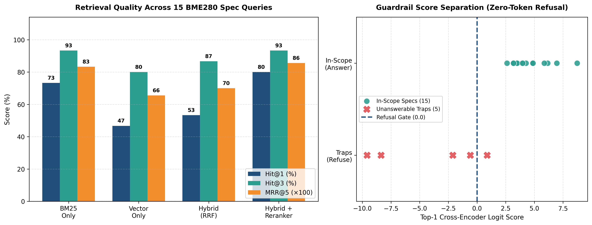

# 🔧 TechSpec Hybrid RAG — Hardware Datasheet Assistant

A production-oriented, containerized **Hybrid RAG microservice** for querying technical electronics datasheets (**Bosch Sensortec BME280 Datasheet & Handling/Soldering Guide**) with exact table preservation, inline page citations, and a two-layer anti-hallucination refusal guardrail.

---

## 📌 Why Naive Vector RAG Fails on Engineering Datasheets
Pure dense-embedding RAG pipelines struggle on hardware documentation for three reasons:
1. **Exact Identifiers Get Blurred:** Dense vectors often rank conceptual prose above exact hex register addresses (`0xF2`, `0xD0`, `0x76`/`0x77`) or pin symbols (`osrs_h`, `VDDIO`).
2. **Broken Parameter Tables:** Fixed-character chunkers split Markdown/PDF tables mid-row, detaching electrical limits from their column headers and units.
3. **Silent Hallucination on Out-of-Scope Specs:** Vector search always returns a nearest neighbor—even when asked about a completely different microcontroller or unsupported wireless feature.

---

## ⚙️ System Architecture
* **Table-Aware PDF Ingestion (`app/rag/ingest.py`):** Uses `pymupdf4llm` with `page_chunks=True` to preserve exact 1-based page numbers, section headers, and intact Markdown parameter tables (repeating header rows if oversized tables split).
* **Hybrid Retrieval + Reranking (`app/rag/retriever.py`):** Combines a custom technical-token **BM25** lexical index with **Qdrant + `BAAI/bge-small-en-v1.5`** dense vectors via **Reciprocal Rank Fusion (RRF, $k=60$)**, followed by **`cross-encoder/ms-marco-MiniLM-L-6-v2`** reranking.
* **Two-Layer Anti-Hallucination Guardrail (`app/rag/generator.py`):**
  1. **Layer 1 (Deterministic Pre-LLM Gate):** Rejects queries whose top Cross-Encoder logit falls below `0.0`—blocking out-of-scope traps in milliseconds with zero LLM API calls.
  2. **Layer 2 (Structured Schema + Citation Verification):** Uses `google-genai` (`gemini-3.5-flash-lite`) with exponential backoff retries, strict Pydantic JSON output, and deterministic verification that every cited `chunk_id` exists in the retrieved top-$k$ context.
* **Production Packaging (`app/main.py`, `Dockerfile`, `docker-compose.yml`):** Exposes `/query`, `/health`, and `/metrics` via FastAPI (`lifespan` lifecycle management) paired with a decoupled Streamlit UI and automated `pytest` CI suite.

---

## 📊 Automated Evaluation Benchmark (20-Question Golden Suite)
Evaluated across **15 real BME280 hardware/register/soldering questions** plus **5 unanswerable hallucination traps** (`eval/golden_dataset.json`):

| Retrieval Mode | Hit@1 (%) | Hit@3 (%) | Hit@5 (%) | MRR@5 | Avg Latency (ms) |
| :--- | :---: | :---: | :---: | :---: | :---: |
| 1. BM25-Only (Lexical) | `[XX.X]` | `[XX.X]` | `[XX.X]` | `[0.XXXX]` | `[XXX.X]` |
| 2. Vector-Only (Dense BGE) | `[XX.X]` | `[XX.X]` | `[XX.X]` | `[0.XXXX]` | `[XXX.X]` |
| 3. Hybrid (BM25 + Vector RRF) | `[XX.X]` | `[XX.X]` | `[XX.X]` | `[0.XXXX]` | `[XXX.X]` |
| **4. Hybrid RRF + Cross-Encoder** | **`[XX.X]`** | **`[XX.X]`** | **`[XX.X]`** | **`[0.XXXX]`** | **`[XXX.X]`** |

### End-to-End Guardrail & Grounding Audit
* **In-Scope Exact Spec & Citation Pass Rate:** `[XX/15 (XX.X%)]`
* **Unanswerable Trap Refusal Accuracy:** `[5/5 (100.0%)]` *(zero-token Layer 1 bypass)*
* **Cross-Encoder Separation Margin:** Lowest in-scope `[+X.XXX]` vs. highest trap `[-X.XXX]`



---

## 📁 Repository Structure
```text
techspec-hybrid-rag/
├── app/
│   ├── main.py              # FastAPI service (/query, /health, /metrics)
│   ├── config.py            # Environment-driven Settings
│   ├── schemas.py           # Pydantic API, citation & telemetry contracts
│   └── rag/
│       ├── ingest.py        # Table-aware PDF parser & page-tracked chunking
│       ├── retriever.py     # Technical BM25 + Qdrant Vector + RRF + Cross-Encoder
│       └── generator.py     # Gemini 3.5 Flash-Lite + retry + 2-layer guardrail
├── ui/
│   └── streamlit_app.py     # Thin Streamlit frontend calling FastAPI over HTTP
├── eval/
│   ├── golden_dataset.json  # 15 BME280 spec questions + 5 unanswerable traps
│   └── run_eval.py          # 4-mode retrieval & guardrail benchmark script
├── tests/
│   └── test_api.py          # Offline pytest suite (API, metrics & guardrail)
├── scripts/
│   └── download_datasheets.py
├── images/
│   └── 01_retrieval_benchmark.png
├── Dockerfile
├── docker-compose.yml
├── requirements.txt
└── .env.example
```

---

## 🚀 Quickstart with Docker Compose
```bash
git clone [https://github.com/LeaderTrusty/techspec-hybrid-rag.git](https://github.com/LeaderTrusty/techspec-hybrid-rag.git)
cd techspec-hybrid-rag

# 1. Configure your free Gemini API key
cp .env.example .env
# Edit .env and paste your GEMINI_API_KEY

# 2. Download the Bosch Sensortec PDFs (if not already in data/datasheets/)
python scripts/download_datasheets.py

# 3. Build and launch FastAPI (:8000) + Streamlit UI (:8501)
docker compose up --build
```

* **Streamlit UI:** `http://localhost:8501`
* **FastAPI Swagger Docs:** `http://localhost:8000/docs`
* **Health Check:** `http://localhost:8000/health`
* **Live Telemetry:** `http://localhost:8000/metrics`

---

## 🧪 Running Automated Tests
```bash
pip install -r requirements.txt
PYTHONPATH=. pytest -v
```

---

## 📂 Data Sources & Attribution
* **Bosch Sensortec BME280 Datasheet (`BST-BME280-DS002`):** Official public hardware specification, Bosch Sensortec GmbH.
* **Bosch Sensortec BME280 Handling, Soldering & Mounting Instructions (`BST-BME280-HS006`):** Official public assembly specification, Bosch Sensortec GmbH.
